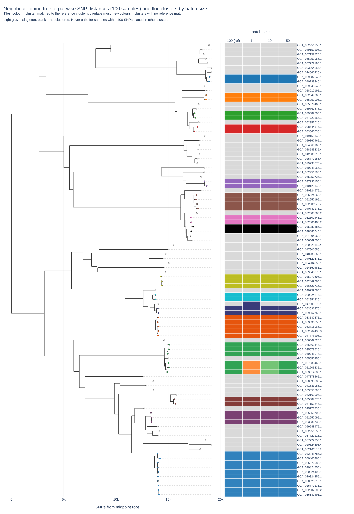
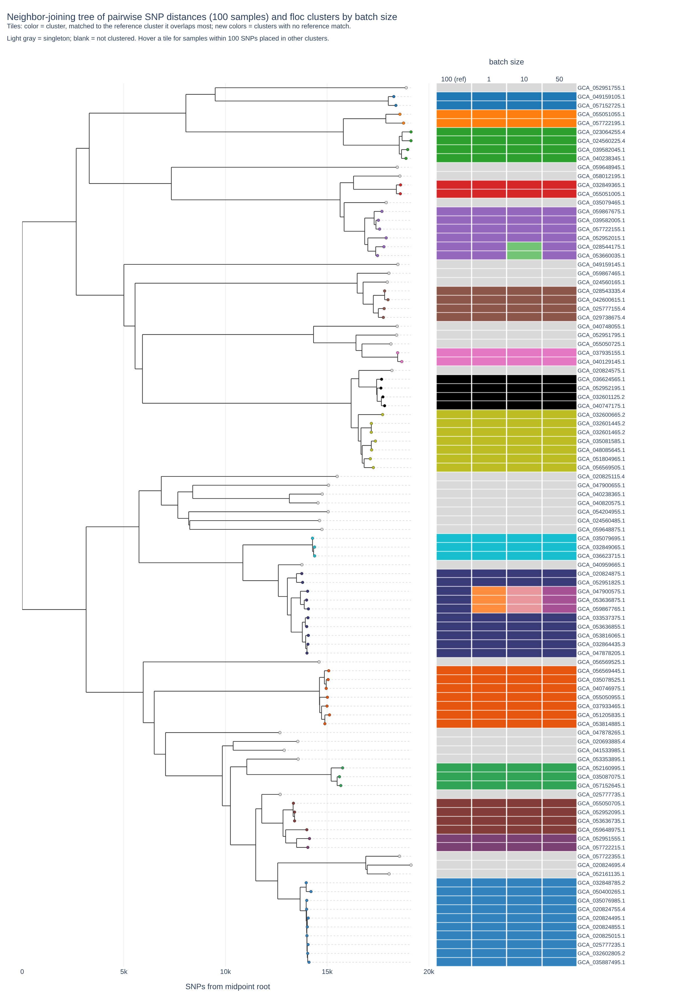
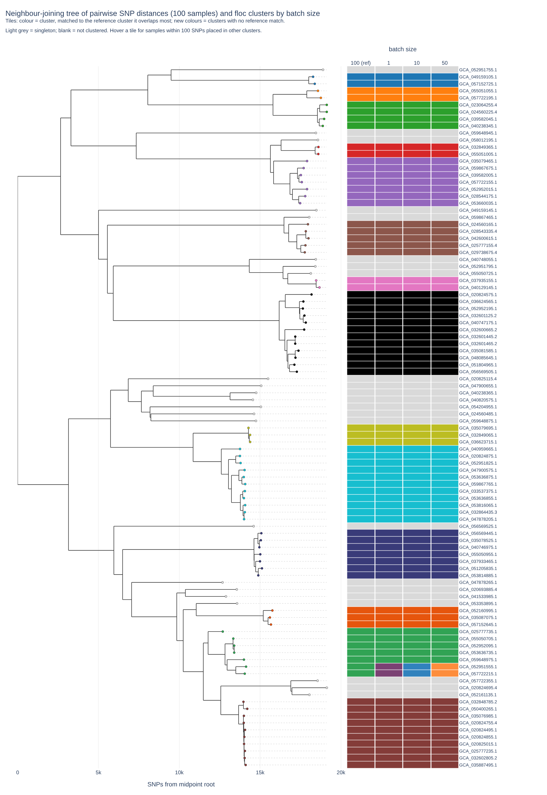
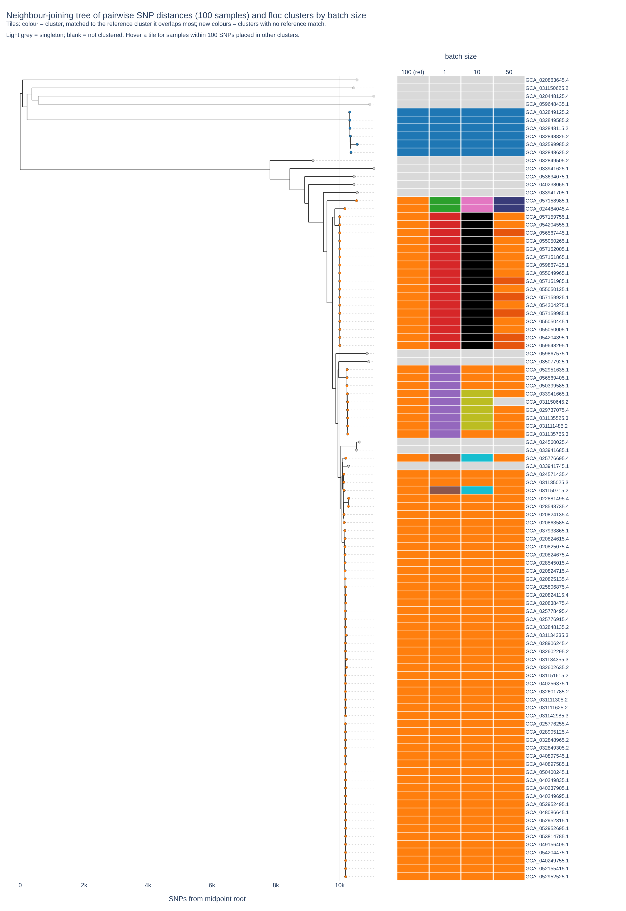
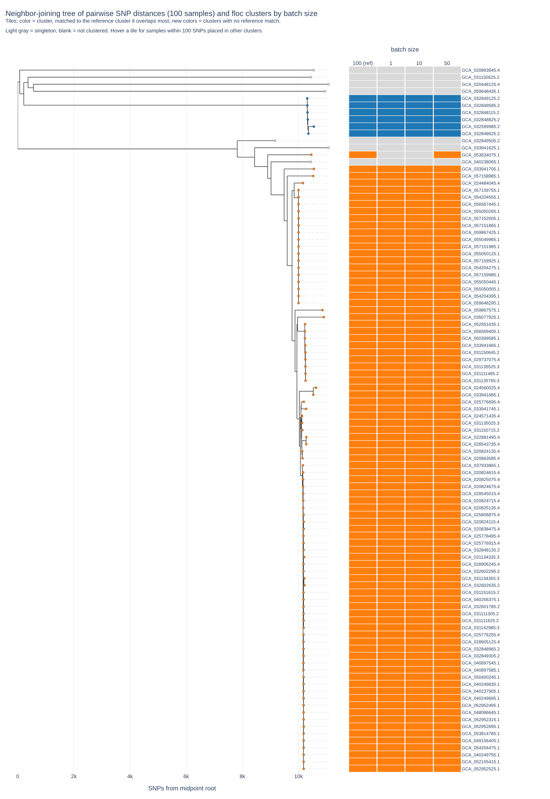
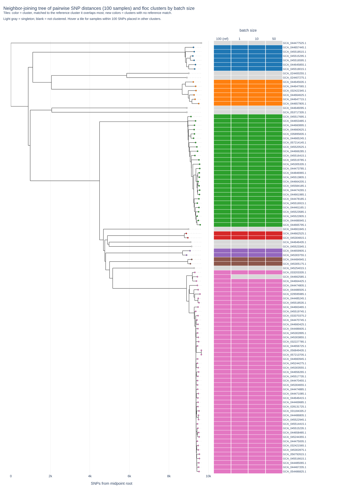

# Evaluation: does batch size change the clusters?
In routine surveillance, samples arrive a few at a time, so floc is run over and over against the same database. The **batch size** is the number of samples added to the floc database on each iteration. With a batch size of 10, the first 10 samples are clustered, the next 10 are added to that database (`floc new_batch/ db/sigs/ -o db/`), and so on until every sample has been added. Ideally, the final clusters should be the same whether samples are added one at a time or all at once.

We tested this with [floc_val](https://github.com/DOH-JDJ0303/floc_val), a Nextflow pipeline that runs floc on the same assemblies at several batch sizes and compares the final clusters with each other and with pairwise SNP distances from [SKA2](https://github.com/bacpop/ska.rust). Samples are added in the same seeded random order at every batch size. The run that adds all samples in a single batch (batch size 100) is the reference.

## Summary
**A distance threshold of 0.075 is the minimum needed to reliably keep closely related samples together, but 0.1 gave more consistent clusters between batch sizes, so floc's default `--distance` is 0.1.** How samples are added can change how some clusters form, but at 0.075 and 0.10, samples within 100 SNPs of each other ended up in the same cluster at every batch size in all three datasets. At 0.05, this held for _E. coli_ and _S. aureus_ but not for _A. baumannii_.

At 0.10, batch sizes 1, 10 and 50 gave the same clusters as each other in every dataset. They matched the reference exactly for _A. baumannii_ and _S. aureus_, and for _E. coli_ they all split the same single reference cluster. At 0.075, the results varied more with batch size: _E. coli_ gave 45, 46 and 45 clusters at batch sizes 1, 10 and 50, and _A. baumannii_ gave 10, 10 and 9.

The table shows the lowest percentage of close pairs kept together across batch sizes 1, 10 and 50 (see [Metrics](#metrics)).

|Organism|Close pairs (within 100 SNPs)|0.05|0.075|0.10|
|-|-|-|-|-|
|_E. coli_|31|100%|100%|100%|
|_A. baumannii_|1,140|**93.4%**|100%|100%|
|_S. aureus_|4|100%|100%|100%|

Raising the threshold also makes clusters more diverse. The largest SNP distance between two samples in the same cluster (reference runs) was:

|Organism|0.05|0.075|0.10|
|-|-|-|-|
|_E. coli_|1,113|2,168|4,134|
|_A. baumannii_|1,655|3,359|3,359|
|_S. aureus_|1,528|1,528|1,528|

For _E. coli_, clusters at 0.10 span about twice as many SNPs as at 0.075 (4,134 vs about 2,000). For _A. baumannii_, the most diverse cluster was the same at 0.075 and 0.10. For _S. aureus_, the clusters did not change between thresholds. The more consistent clusters at 0.10 therefore come at the cost of broader _E. coli_ clusters.

## Datasets
|Organism|Assemblies|Source|Selection|
|-|-|-|-|
|_Escherichia coli_|100|Clinical isolates sequenced at the Washington State Public Health Laboratory (WAPHL), BioProject [PRJNA288601](https://www.ncbi.nlm.nih.gov/bioproject/PRJNA288601)|100 _E. coli_ assemblies from the BioProject|
|_Acinetobacter baumannii_|100|Clinical isolates sequenced at WAPHL, BioProject [PRJNA288601](https://www.ncbi.nlm.nih.gov/bioproject/PRJNA288601)|100 _A. baumannii_ assemblies from the BioProject|
|_Staphylococcus aureus_|100|BioProject [PRJNA533550](https://www.ncbi.nlm.nih.gov/bioproject/PRJNA533550)|Randomly selected from the BioProject's assembly list with `tail -n +2 assemblies.tsv \| shuf \| head -n 100`|

## Design
|Setting|Values|
|-|-|
|floc version|v1.2.4 (`public.ecr.aws/o8h2f0o1/floc:1.2.4`)|
|Batch sizes|1, 10, 50 and 100 (100 = all samples at once, the reference)|
|Distance thresholds (`--distance`)|0.05, 0.075 and 0.10|
|Other floc options|floc v1.2.4 defaults (including `--assign-hash-freq 0.6`)|

Each dataset and threshold combination was run with:
```
nextflow run DOH-JDJ0303/floc_val \
    --assemblies ecoli/ \
    --outdir ecoli_05 \
    --max_samples 100 \
    --batch_sizes 1,10,50 \
    --floc_distance 0.05 \
    --floc_container public.ecr.aws/o8h2f0o1/floc:1.2.4
```
The reference run (batch size 100) is added automatically.

## Metrics
|Metric|Meaning|
|-|-|
|Clusters|Number of clusters, including singletons|
|Singletons|Samples that are alone in their cluster|
|Max SNPs within a cluster|Largest SNP distance between two samples in the same cluster; shows how diverse the clusters are|
|Min SNPs between clusters|Smallest SNP distance between two samples in different clusters; a low value means closely related samples were placed in different clusters|
|Close pairs kept together|Percentage of sample pairs within 100 SNPs of each other that were placed in the same cluster; 100% means no closely related samples were separated|

The full statistics for each run are in the linked metrics files.

### Reading the plots
Each plot is a neighbour-joining tree of pairwise SNP distances with one column of tiles per batch size. Each tile is coloured to match the reference cluster it overlaps most. New colours are clusters with no match in the reference, and light grey tiles are singletons. GitHub cannot display interactive HTML, so the plots are static images; download the linked `.html` file and open it in a browser to hover over tiles.

## Results: _E. coli_
31 pairs of samples are within 100 SNPs of each other.

|Distance|Batch size|Clusters|Singletons|Max SNPs within a cluster|Min SNPs between clusters|Close pairs kept together|
|-|-|-|-|-|-|-|
|0.05|100 (reference)|65|49|1,113|138|100%|
|0.05|1|65|48|1,113|138|100%|
|0.05|10|66|49|1,113|138|100%|
|0.05|50|65|49|1,113|138|100%|
|0.075|100 (reference)|44|28|2,168|1,602|100%|
|0.075|1|45|28|2,034|1,470|100%|
|0.075|10|46|28|2,013|1,266|100%|
|0.075|50|45|28|2,034|1,470|100%|
|0.10|100 (reference)|37|23|4,134|2,758|100%|
|0.10|1|38|23|4,134|1,602|100%|
|0.10|10|38|23|4,134|1,602|100%|
|0.10|50|38|23|4,134|1,602|100%|

- **0.05:** batch size 50 gave the same clusters as the reference. At batch sizes 1 and 10, a six-sample reference cluster was split into two clusters, and at batch size 1 one reference singleton joined a neighbouring cluster.
- **0.075:** smaller batch sizes split one (batch sizes 1 and 50) or two (batch size 10) reference clusters into smaller clusters.
- **0.10:** at every batch size below 100, a seven-sample reference cluster was split into two clusters. This is why the smallest distance between clusters drops from 2,758 to 1,602 SNPs.
- At every threshold and batch size, all 31 close pairs stayed in the same cluster.

<details>
<summary><i>E. coli</i>, 0.05 (<a href="evaluation/ecoli_05.nj_tree_clusters.html">interactive</a>, <a href="evaluation/ecoli_05.run_metrics.tsv">metrics</a>)</summary>


</details>

<details>
<summary><i>E. coli</i>, 0.075 (<a href="evaluation/ecoli_075.nj_tree_clusters.html">interactive</a>, <a href="evaluation/ecoli_075.run_metrics.tsv">metrics</a>)</summary>


</details>

<details>
<summary><i>E. coli</i>, 0.10 (<a href="evaluation/ecoli_10.nj_tree_clusters.html">interactive</a>, <a href="evaluation/ecoli_10.run_metrics.tsv">metrics</a>)</summary>


</details>

## Results: _A. baumannii_
1,140 pairs of samples are within 100 SNPs of each other.

|Distance|Batch size|Clusters|Singletons|Max SNPs within a cluster|Min SNPs between clusters|Close pairs kept together|
|-|-|-|-|-|-|-|
|0.05|100 (reference)|16|14|1,655|89|**99.9%**|
|0.05|1|20|14|1,478|41|**99.6%**|
|0.05|10|20|14|1,478|3|**97.8%**|
|0.05|50|19|15|1,478|0|**93.4%**|
|0.075|100 (reference)|9|7|3,359|2,437|100%|
|0.075|1|10|8|2,229|2,437|100%|
|0.075|10|10|8|2,229|2,437|100%|
|0.075|50|9|7|3,359|2,437|100%|
|0.10|100 (reference)|8|6|3,359|3,540|100%|
|0.10|1|8|6|3,359|3,540|100%|
|0.10|10|8|6|3,359|3,540|100%|
|0.10|50|8|6|3,359|3,540|100%|

- **0.05:** most of these samples belong to one large, closely related group, which the reference keeps in a single cluster. At smaller batch sizes, this group was divided into several clusters, separating up to 6.6% of close pairs (75 pairs involving 28 samples at batch size 50), including identical pairs (0 SNPs). Even the reference run split one pair (89 SNPs).
- **0.075:** batch sizes 1 and 10 separated one distant sample from its reference cluster, making it a singleton. Batch size 50 matched the reference exactly. No close pairs were separated.
- **0.10:** every batch size matched the reference exactly.

<details>
<summary><i>A. baumannii</i>, 0.05 (<a href="evaluation/abaum_05.nj_tree_clusters.html">interactive</a>, <a href="evaluation/abaum_05.run_metrics.tsv">metrics</a>)</summary>


</details>

<details>
<summary><i>A. baumannii</i>, 0.075 (<a href="evaluation/abaum_075.nj_tree_clusters.html">interactive</a>, <a href="evaluation/abaum_075.run_metrics.tsv">metrics</a>)</summary>


</details>

<details>
<summary><i>A. baumannii</i>, 0.10 (<a href="evaluation/abaum_10.nj_tree_clusters.html">interactive</a>, <a href="evaluation/abaum_10.run_metrics.tsv">metrics</a>)</summary>


</details>

## Results: _S. aureus_
4 pairs of samples are within 100 SNPs of each other.

|Distance|Batch size|Clusters|Singletons|Max SNPs within a cluster|Min SNPs between clusters|Close pairs kept together|
|-|-|-|-|-|-|-|
|0.05|100 (reference)|16|9|1,528|6,194|100%|
|0.05|1|17|10|1,528|412|100%|
|0.05|10|17|10|1,528|412|100%|
|0.05|50|17|10|1,528|412|100%|
|0.075|100 (reference)|16|9|1,528|6,194|100%|
|0.075|1|16|9|1,528|6,194|100%|
|0.075|10|16|9|1,528|6,194|100%|
|0.075|50|16|9|1,528|6,194|100%|
|0.10|100 (reference)|16|9|1,528|6,194|100%|
|0.10|1|16|9|1,528|6,194|100%|
|0.10|10|16|9|1,528|6,194|100%|
|0.10|50|16|9|1,528|6,194|100%|

- **0.05:** at every batch size below 100, one sample (GCA_044662585.1) left the largest reference cluster and became a singleton. Because it is now separated from relatives it was grouped with, the smallest distance between clusters drops from 6,194 to 412 SNPs. No close pairs were separated.
- **0.075 and 0.10:** every batch size matched the reference exactly, and gave the same clusters as the 0.05 reference.
- This dataset has only 4 close pairs, so it says less about keeping close pairs together than the other two datasets.

<details>
<summary><i>S. aureus</i>, 0.05 (<a href="evaluation/staph_05.nj_tree_clusters.html">interactive</a>, <a href="evaluation/staph_05.run_metrics.tsv">metrics</a>)</summary>


</details>

<details>
<summary><i>S. aureus</i>, 0.075 (<a href="evaluation/staph_075.nj_tree_clusters.html">interactive</a>, <a href="evaluation/staph_075.run_metrics.tsv">metrics</a>)</summary>


</details>

<details>
<summary><i>S. aureus</i>, 0.10 (<a href="evaluation/staph_10.nj_tree_clusters.html">interactive</a>, <a href="evaluation/staph_10.run_metrics.tsv">metrics</a>)</summary>


</details>
