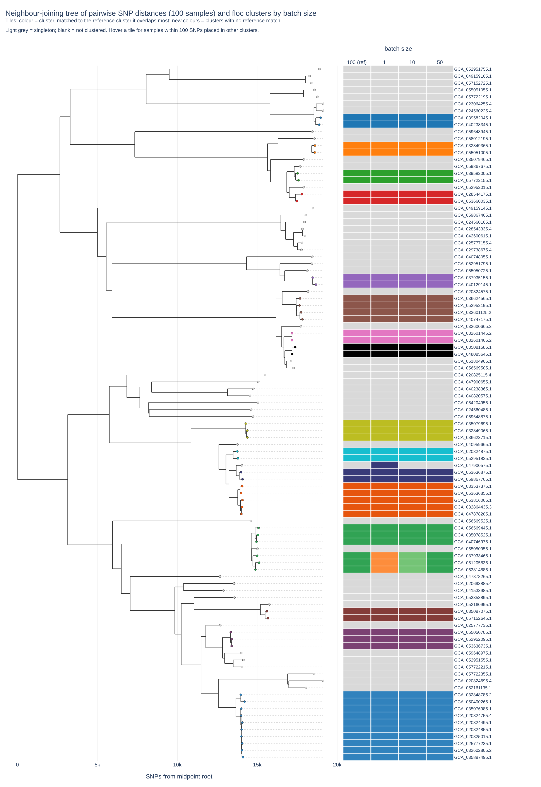
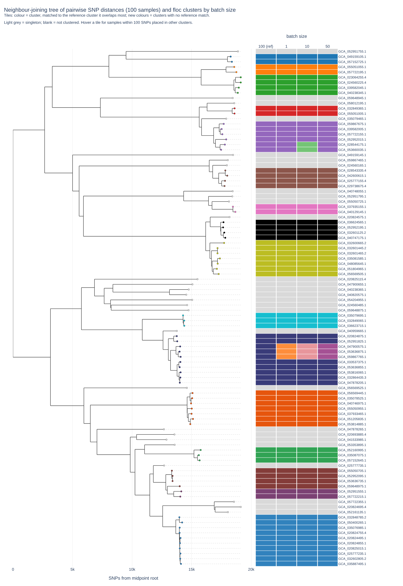
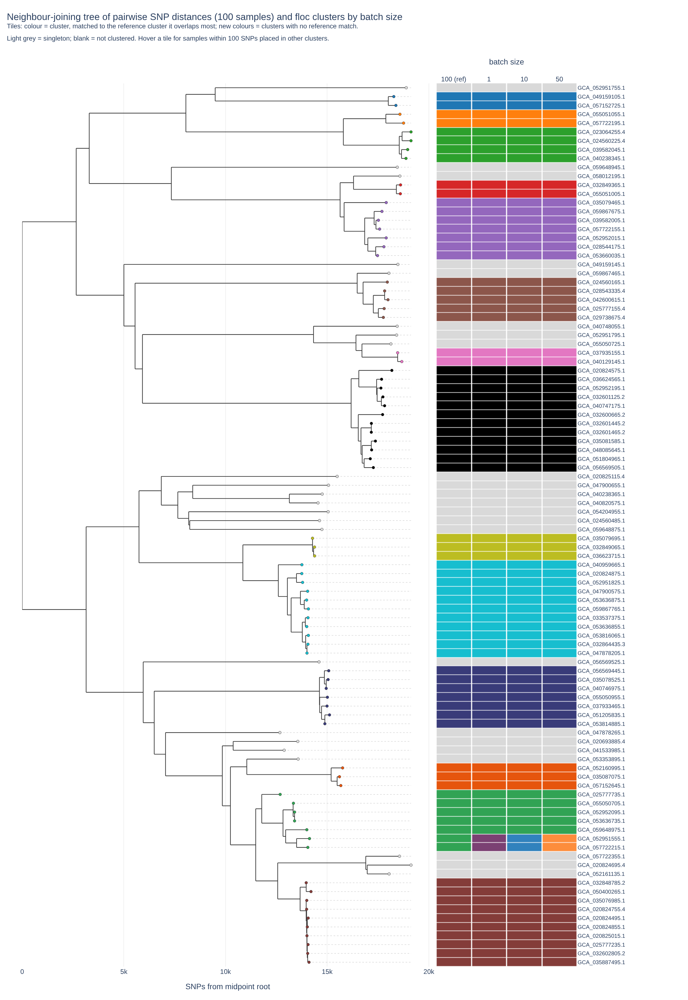
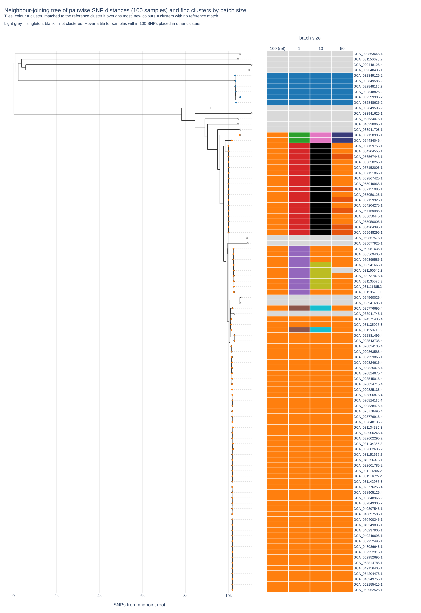
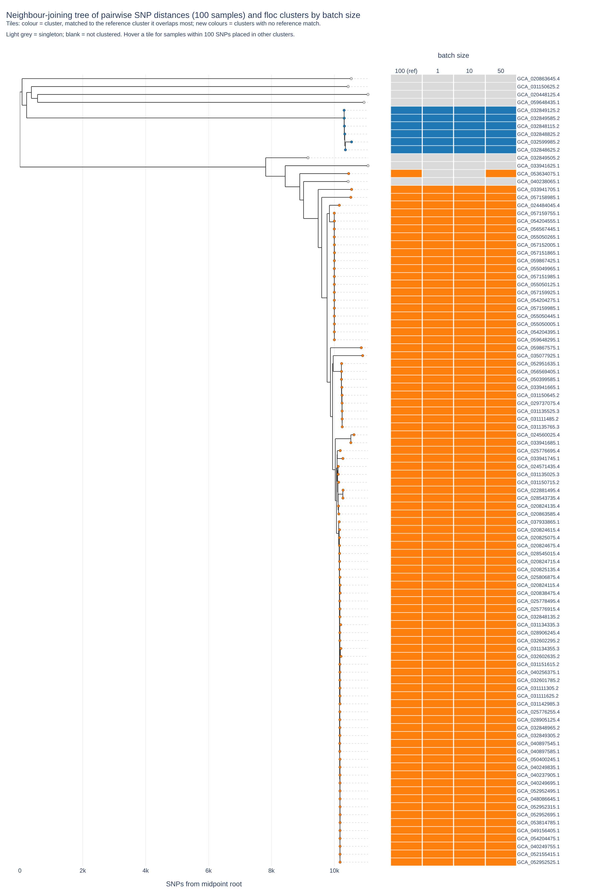

# Validation: does batch size change the clusters?
In routine surveillance, samples arrive a few at a time, so floc is run over and over against the same database. The **batch size** is the number of samples added to the floc database on each iteration: with a batch size of 10, the first 10 samples are clustered, the next 10 are added to that database (`floc new_batch/ db/sigs/ -o db/`), and so on until every sample has been added. Ideally the final clusters should be the same whether samples are added one at a time or all at once.

We tested this with [floc_val](https://github.com/DOH-JDJ0303/floc_val), a Nextflow pipeline that runs floc on the same assemblies at several batch sizes (always in the same seeded random order) and compares the final clusters with each other and with pairwise SNP distances from [SKA2](https://github.com/bacpop/ska.rust). The run that adds all samples in a single batch is used as the reference.

## Design
|Setting|Values|
|-|-|
|floc version|v1.2.4 (`public.ecr.aws/o8h2f0o1/floc:1.2.4`)|
|Organisms|_Escherichia coli_ and _Acinetobacter baumannii_ (100 clinical assemblies each)|
|Batch sizes|1, 10, 50 and 100 (100 = all samples at once, the reference)|
|Distance threshold (`--distance`)|0.05, 0.075 and 0.10|
|Other floc options|floc v1.2.4 defaults (including `--assign-hash-freq 0.6`)|

Each organism and threshold combination was run with:
```
nextflow run DOH-JDJ0303/floc_val \
    --assemblies ecoli/ \
    --outdir ecoli_05 \
    --max_samples 100 \
    --batch_sizes 1,10,50 \
    --floc_distance 0.05 \
    --floc_container public.ecr.aws/o8h2f0o1/floc:1.2.4
```
The all-samples reference run (batch size 100) is added automatically.

## Results
**Conclusion:** a distance threshold of **0.075** is needed to reliably keep samples together. How samples are added can change how some clusters form, but at 0.075 and 0.10, samples that belong together (within 100 SNPs of each other) ended up in the same cluster at every batch size for both organisms. At 0.05 this held for _E. coli_ but not for _A. baumannii_. Based on these results, floc's default `--distance` is 0.075.

**Close pairs kept together** is the percentage of sample pairs within 100 SNPs of each other that floc placed in the same cluster (31 such pairs for _E. coli_, 1,140 for _A. baumannii_). 100% means no closely related samples were separated. **Max SNPs within a cluster** is the largest SNP distance between two samples in the same cluster, which shows how diverse the clusters become. Values are given for batch sizes 100 (reference) / 1 / 10 / 50.

|Organism|Distance|Clusters|Max SNPs within a cluster|Close pairs kept together|
|-|-|-|-|-|
|_E. coli_|0.05|65 / 65 / 66 / 65|1,113 / 1,113 / 1,113 / 1,113|100% / 100% / 100% / 100%|
|_E. coli_|0.075|44 / 45 / 46 / 45|2,168 / 2,034 / 2,013 / 2,034|100% / 100% / 100% / 100%|
|_E. coli_|0.10|37 / 38 / 38 / 38|4,134 / 4,134 / 4,134 / 4,134|100% / 100% / 100% / 100%|
|_A. baumannii_|0.05|16 / 20 / 20 / 19|1,655 / 1,478 / 1,478 / 1,478|**99.9% / 99.6% / 97.8% / 93.4%**|
|_A. baumannii_|0.075|9 / 10 / 10 / 9|3,359 / 2,229 / 2,229 / 3,359|100% / 100% / 100% / 100%|
|_A. baumannii_|0.10|8 / 8 / 8 / 8|3,359 / 3,359 / 3,359 / 3,359|100% / 100% / 100% / 100%|

- **_E. coli_:** at every threshold, smaller batch sizes split one or two reference clusters into smaller clusters, but never separated samples within 100 SNPs of each other.
- **_A. baumannii_, 0.05:** most of these samples belong to one large, closely related group, which the reference keeps in a single cluster. At smaller batch sizes this group was divided into several clusters, separating up to 6.6% of close pairs (75 pairs involving 28 samples), including identical pairs (0 SNPs) at batch size 50. Even the reference split one pair (89 SNPs).
- **_A. baumannii_, 0.075 and 0.10:** no close pairs were split. At 0.075, batch sizes 1 and 10 separated one distant sample from its reference cluster; at 0.10, every batch size matched the reference exactly.
- **Cluster diversity grows with the threshold.** The largest SNP distance within a cluster rises from about 1,100 to 4,100 SNPs for _E. coli_ and from about 1,500 to 3,400 SNPs for _A. baumannii_ as the threshold goes from 0.05 to 0.10. A higher threshold keeps close pairs together more reliably, but each cluster also takes in more distantly related samples. 0.075 is the lowest threshold tested that kept every close pair together. For _E. coli_, its clusters span about half as many SNPs as at 0.10 (about 2,000 vs 4,134); for _A. baumannii_, the most diverse cluster at 0.075 already matched 0.10 (3,359 SNPs).

## Plots
Each plot is a neighbour-joining tree of pairwise SNP distances with one column of tiles per batch size. Each tile is coloured to match the reference cluster it overlaps most; new colours are clusters with no match in the reference, and light grey tiles are singletons. GitHub cannot display interactive HTML, so the plots below are static images; download the linked `.html` file and open it in a browser to hover over tiles. The linked metrics files have the full statistics for each run.

<details>
<summary><i>E. coli</i>, 0.05 (<a href="validation/ecoli_05.nj_tree_clusters.html">interactive</a>, <a href="validation/ecoli_05.run_metrics.tsv">metrics</a>)</summary>


</details>

<details>
<summary><i>E. coli</i>, 0.075 (<a href="validation/ecoli_075.nj_tree_clusters.html">interactive</a>, <a href="validation/ecoli_075.run_metrics.tsv">metrics</a>)</summary>


</details>

<details>
<summary><i>E. coli</i>, 0.10 (<a href="validation/ecoli_10.nj_tree_clusters.html">interactive</a>, <a href="validation/ecoli_10.run_metrics.tsv">metrics</a>)</summary>


</details>

<details>
<summary><i>A. baumannii</i>, 0.05 (<a href="validation/abaum_05.nj_tree_clusters.html">interactive</a>, <a href="validation/abaum_05.run_metrics.tsv">metrics</a>)</summary>


</details>

<details>
<summary><i>A. baumannii</i>, 0.075 (<a href="validation/abaum_075.nj_tree_clusters.html">interactive</a>, <a href="validation/abaum_075.run_metrics.tsv">metrics</a>)</summary>


</details>

<details>
<summary><i>A. baumannii</i>, 0.10 (<a href="validation/abaum_10.nj_tree_clusters.html">interactive</a>, <a href="validation/abaum_10.run_metrics.tsv">metrics</a>)</summary>


</details>
